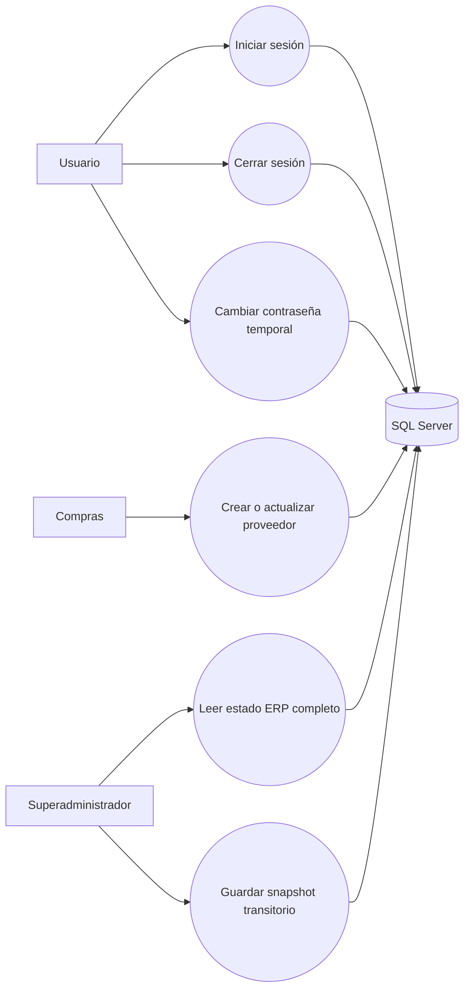
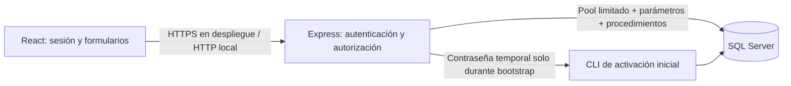
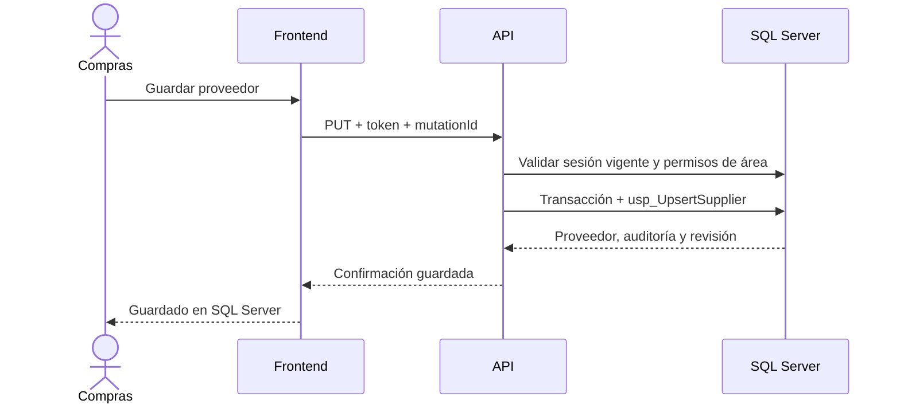
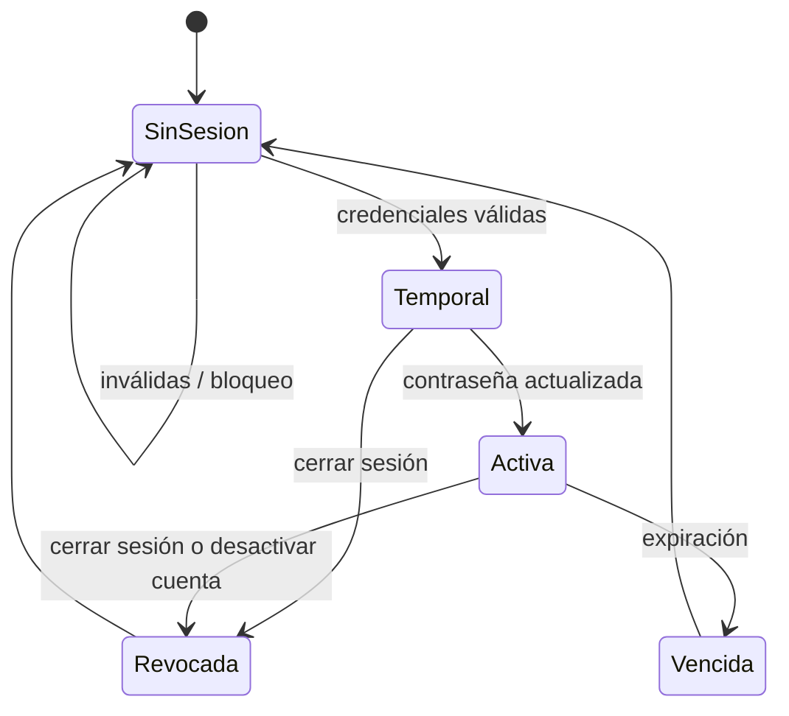

# Estado, requisitos y trazabilidad del ERP

Este documento separa comportamiento comprobado, implementacion parcial y trabajo propuesto. La existencia de una pantalla o control visual no se considera evidencia de una regla de negocio.

## Catálogo priorizado

| ID | Módulo / actor | Regla | Prioridad | Criterio de aceptación | Prueba / evidencia | Estado |
|---|---|---|---|---|---|---|
| AUTH-01 | Acceso / todos | El backend valida usuario activo y contraseña bcrypt en SQL Server; el navegador no decide la identidad. | P0 | Sin hash no se inicia sesión; respuesta no contiene hash ni contraseña. | Build y sintaxis revisados; integración pendiente de aplicar 13 y configurar .env. | Implementado, no habilitado en la base |
| AUTH-02 | Acceso / usuario | Sesiones con expiración y revocación comprobadas en cada petición protegida. | P0 | Sesión vencida o revocada recibe 401. | Requiere prueba integrada tras migración 13. | Implementado, pendiente de prueba |
| AUTH-03 | Acceso / todos | Cinco intentos inválidos bloquean la cuenta por 15 minutos. | P0 | Reintentos simultáneos no evitan el bloqueo y no se registran contraseñas en logs. | Revisar `usp_RecordFailedAppLogin` y validar con prueba de integración. | Implementado en migración, pendiente de prueba |
| AUTH-04 | Usuarios / superadministrador | La cuenta de activación inicial usa contraseña temporal, cambio obligatorio y no se permite alterar el rol por el snapshot. | P0 | Un solo bootstrap exitoso; después se rechaza un segundo; el usuario cambia la contraseña al entrar. | `npm run db:bootstrap-user`; no ejecutado. | Implementado, falta aprovisionamiento de otras cuentas |
| AUTHZ-01 | Proveedores / Compras | La API valida sesión, estado, jerarquía y área de Compras; ocultar botones no basta. | P0 | Invitado sin escritura; estándar de Compras puede guardar; identidad auditada proviene de la sesión. | Ruta `PUT /api/suppliers/:id`; requiere prueba integrada. | Implementado, pendiente de prueba |
| AUTHZ-02 | Estado ERP / superadministrador | Snapshot completo solo se expone y actualiza bajo superadministración hasta reemplazarlo por APIs por módulo. | P0 | Otras jerarquías reciben 403 y no pueden extraer datos sensibles del estado completo. | Middleware de `/api/state`; prueba HTTP pendiente. | Implementado, pendiente de prueba |
| DATA-01 | Proveedores / Compras | SQL Server es la fuente confirmada; un cambio se confirma solo después de guardar registro, auditoría y snapshot en transacción. | P0 | Editar correo, consultar `dbo.Parties.Email` y recargar muestra el mismo valor. | Procedimiento 12 y consulta del README; escritura no ejecutada. | Implementado, pendiente de prueba |
| DATA-02 | Proveedores / Compras | Los reintentos conservan la misma identidad de mutación y no duplican el proveedor. | P0 | Repetir una petición conserva un único registro y auditoría idempotente. | Debe probarse tras migración 12. | Implementado, pendiente de prueba |
| DATA-03 | Demás módulos / usuarios autorizados | Clientes, productos, compras, ventas y movimientos deben guardarse por operación de negocio, no borrando/reinsertando colecciones completas. | P0 | Un cambio de un registro no altera registros ajenos y es atómico con sus relaciones. | `usp_SaveErpState` aún reemplaza colecciones de negocio. | Pendiente |
| CONC-01 | Todos / usuarios simultáneos | Las modificaciones concurrentes detectan versión obsoleta y no sobrescriben silenciosamente. | P0 | Dos editores del mismo registro reciben conflicto o resultado serializado verificable. | El snapshot usa rowversion; proveedores usan transacción serializable. Pruebas concurrentes pendientes. | Parcial |
| AUD-01 | Todos / usuarios autorizados | La auditoría identifica usuario, fecha, acción, entidad y resultado desde la identidad validada por API. | P0 | Actor no puede suplantarse alterando el JSON del navegador. | Proveedor toma actor de sesión; otros módulos aún no. | Parcial |
| SUP-01 | Proveedores / Compras | Evitar duplicados por nombre normalizado o identificación fiscal sin coincidencias por similitud aproximada. | P1 | Duplicado exacto devuelve conflicto; nombre parecido válido puede guardarse. | Índices y procedimiento 12; las colisiones se consultaron como cero antes de la migración. | Implementado, pendiente de prueba |
| PUR-01 | Compras / Comprador y aprobador | Solicitud, autorización, orden, recepción parcial/devolución y CxP tienen estados y responsables diferenciados. | P1 | Recepción repetida es idempotente y no excede cantidades autorizadas. | No se verificó el flujo completo. | Propuesto / pendiente |
| INV-01 | Inventario / operador y aprobador | Unidades, reservas, lotes, ajustes y saldos disponibles son consistentes y no generan stock negativo bajo concurrencia. | P1 | Dos usuarios no venden simultáneamente la última unidad; ajustes tienen motivo y autorización. | No se ejecutaron pruebas de concurrencia. | Propuesto / pendiente |
| SALES-01 | Ventas / vendedor y aprobador | Cotizaciones versionadas, crédito, descuentos, factura, cobro y devoluciones siguen transiciones autorizadas. | P1 | No se salta aprobación y el cobro repetido no duplica movimientos. | Facturación fiscal y concurrencia pendientes. | Propuesto / pendiente |
| OPS-01 | Producción y proyectos / supervisor | Órdenes y proyectos enlazan medidas, materiales, costos, etapas, calidad y evidencia de entrega. | P1 | Consumo real, desperdicio y retrabajo quedan trazables al proyecto. | Proyectos se persisten en SQL con eventos; enlace a órdenes, costos, medidas y calidad pendiente. | Parcial / pendiente |
| FIN-01 | Finanzas y contabilidad / responsable | Asientos cuadrados, caja separada de utilidad, cierres protegidos y rastreo a documento origen. | P2 | Débitos = créditos y período cerrado no acepta edición directa. | Reglas financieras no verificadas. | Propuesto / pendiente |
| HR-01 | RR. HH. y Nómina / personal autorizado | Expediente y nómina separados; salarios, documentos personales y eventos restringidos por necesidad de acceso. | P2 | Usuario sin permiso no obtiene esos campos por API ni exportación. | Migración 16 y rutas de directorio, alta y solicitudes privadas conectadas; prueba integrada SQL y privacidad aún pendiente. Nómina, contratos, documentos y asistencia no implementados. | Parcial / pendiente |
| LEG-01 | Nómina / responsable legal y financiero | Parámetros legales de Nicaragua se versionan por vigencia, fuente oficial y supuestos revisados. | P2 | Cada nómina conserva la versión de reglas utilizada y casos de cálculo aprobados. | No se verificaron reformas, fuentes oficiales ni tasas en esta etapa. | Revisión legal pendiente |
| TAX-01 | Facturación / administración fiscal | Datos del emisor, régimen, numeración y retenciones se configuran; demostración no equivale a documento fiscal autorizado. | P2 | Numeración única transaccional y documentos anulados conservados. | DGI.ZIP y autorización fiscal no verificados. | Propuesto / validación fiscal pendiente |
| STAT-01 | Estadística y mercadotecnia / gerencia | Cada indicador declara fórmula, origen, período, filtros y si es real o estimado. | P3 | No hay inferencias concluyentes con muestra insuficiente ni atribución automática. | No se verificó con datos de producción. | Propuesto |
| DEP-01 | Operación / administrador | Despliegue, HTTPS, CORS, respaldos y restauración probada desde otros equipos autorizados. | P2 | Restaurar respaldo y comprobar integridad; localhost no se presenta como host de red. | Aún no configurado ni probado. | Pendiente |

## Estado observado en esta etapa

- **Verificado en código:** el proveedor tiene guardado individual parametrizado y una cola local; el snapshot tiene revisión `rowversion`; el login local con usuarios/contraseñas demo fue retirado de la interfaz y del mapeo de datos heredado.
- **Implementado pero sin prueba integrada:** login bcrypt contra SQL Server, bloqueo, sesiones revocables, cambio obligatorio de contraseña temporal y permisos backend de proveedores/estado.
- **Talento humano:** el directorio consulta SQL sin incluir salarios; altas y solicitudes privadas dependen de la migración 16. La lista de solicitudes y decisiones usa identidad de sesión, control de acceso SQL y revisión optimista; las pruebas con SQL Server aún no se han ejecutado. Nómina, contratos, solicitudes documentales, saldos calculados, asistencia y cambios de cargo/salario no tienen todavía flujo transaccional de aplicación.
- **Orientación pública:** `/derechos-y-seguridad` no requiere autenticación y ofrece consejos generales con enlaces a fuentes oficiales; no pretende interpretar normas ni determinar derechos o plazos. Falta revisión editorial y de accesibilidad formal.
- **Pendiente de configuración:** ejecutar las migraciones requeridas en la base existente según la guía SQL Server; no se ha aplicado ninguna migración a la base del usuario desde este cambio. También se requiere configurar `JWT_SECRET`, `PASSWORD_RESET_SECRET` y SMTP para habilitar autenticación y recuperación de contraseña.
- **No debe declararse completado:** provisión y administración de cuentas adicionales; endpoints transaccionales para clientes, inventario, compras, ventas, producción, finanzas y RR. HH.; conversión del snapshot general a operaciones por registro; concurrencia, despliegue, respaldo y carga.
- **Datos demostrativos:** la interfaz conserva una semilla local para vista previa; no es evidencia de datos reales persistidos. Para personal operativo, conectar todos los módulos a SQL Server sigue siendo requisito antes del despliegue.

## RUP: trabajo realizado y siguiente ciclo

| Fase | Aplicación al proyecto | Artefactos / salida |
|---|---|---|
| Inicio | Se recibe la especificación amplia y se ordenan riesgos; no se inventan entrevistas ni aprobación del cliente. | Requisitos priorizados P0-P3 de este catálogo. |
| Elaboración | Se inspeccionan frontend, API y SQL; se encuentra autenticación demo/local, una ruta proveedor previa y el snapshot con reemplazos completos. | Contrato de login/sesión, migración 13 y restricción del snapshot a superadministración. |
| Construcción | Se implementa la primera etapa de autenticación, sesiones y permiso de proveedor; frontend/API compilan y el JS pasa análisis sintáctico. | Archivos en `src/auth`, `src/pages`, `server/src`, migraciones 07 y 13. |
| Transición | Aún no iniciada para usuarios: requiere migrar SQL, configurar secreto, activar cuenta y ejecutar pruebas sobre una base autorizada. | Procedimiento de migración en `Database/SQLServer_Completo/README.md`; pruebas de aceptación todavía pendientes. |

Disciplinas involucradas: requisitos, análisis y diseño, implementación, pruebas, despliegue y gestión de configuración. En esta etapa el desarrollador integra los cambios; no se atribuyen actividades a agentes que no hayan producido evidencia independiente.

## UML de la etapa

### Casos de uso

### Componentes y despliegue

### Secuencia: modificar proveedor

### Estados básicos de sesión

## Comprobaciones disponibles

1. Compilar con `npm run build`.
2. Validar sintaxis con `node --check` en los archivos modificados de `server`.
3. No ejecutar `db:install`, `db:rebuild` ni una migración automáticamente en esta etapa.
4. Después de aplicar 14, probar login temporal/cambio forzado, permisos por perfil, guardado/relectura del correo, cambios concurrentes y recuperación por correo. Registrar cada resultado antes de dar el criterio por verificado.

La navegación y los estados de módulos deben reflejar las capacidades calculadas por la API. Proyectos ya tiene lectura/escritura transaccional en SQL con eventos de auditoría; integración de producción, nómina, reportes, personal y auditoría general aún pendiente se mantiene como propuesta o referencia y no se presenta como función verificada. Ver [Mapa de evidencia](./mapa-evidencia.md) para equivalencias RF13–RF17, pantallas, servicios, datos y pruebas pendientes.
